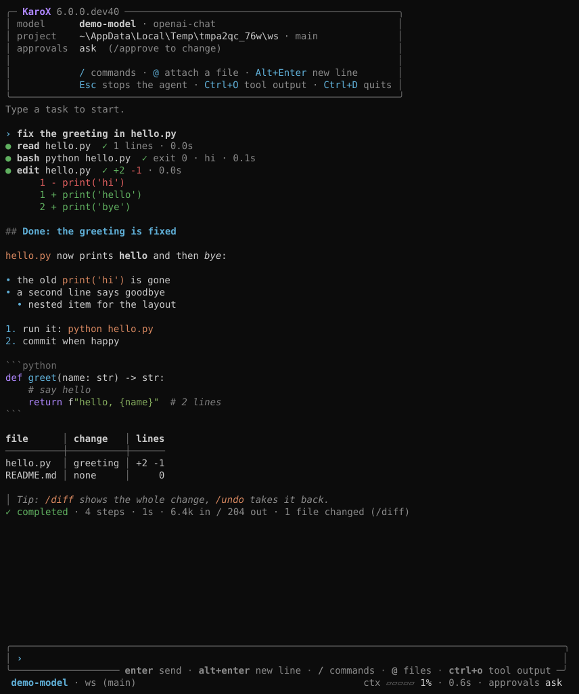

# The chat's look: what was borrowed, and before / after

KaroX 6.0.0.dev40 redraws the chat. This page lists what the best terminal agents do that
KaroX now does too, and shows the same screens before (6.0.0.dev39) and after. Every
screen is the real `karox6 chat` in a pseudo-terminal against the tests' scripted model,
captured by `python scripts/tui_frames.py <folder>` (text, and a picture with the
colours the program sent; dark Windows Terminal palette, truecolor).

## What the others do, and what KaroX took

Sources: Codex CLI's `codex-rs/tui/styles.md` and its streaming markdown, OpenCode's theme
system (`packages/tui/src/context/theme.tsx`, docs/cli/theme), Claude Code's screens and
docs (status line, tool blocks, input box).

1. **Colours are roles, not codes** (Codex `styles.md`: default foreground for text, dim
   for secondary, green/red for success/failure, magenta for the agent). KaroX:
   `karox6/tui_theme.py`, roles `accent`, `brand`, `muted`, `subtle`, `success`, `error`,
   `warning`, `code`, syntax roles; no call site writes a colour code.
2. **Themes follow the terminal** (OpenCode: dark/light modes and a "system" theme from
   the terminal's palette). KaroX: `dark`, `light`, `mid` (readable on either background,
   the default when the terminal does not say) and `ansi` (the terminal's own 16 colours);
   `auto` reads `COLORFGBG`; `theme` setting, `--theme`, `KAROX_THEME`.
3. **Colour depth is detected, `NO_COLOR` is honoured**: truecolor in Windows Terminal,
   VS Code, iTerm2, kitty, WezTerm; 256 colours with the exact palette entry (the start-up
   frame and prompt_toolkit pick the same one); 16; none.
4. **Glyphs that every font has**: three sets: rich (braille spinner, ✓ ✗), the classic
   Windows console (WGL4 only: √ × ● █), and ASCII for other encodings.
5. **Markdown rendered as it streams, a line at a time** (Codex renders only completed
   lines, so formatting never jumps). Headings, lists, quotes, rules, `code`, bold,
   italic, links; the open line is shown live and replaced when it ends.
6. **Code blocks coloured** without a heavy dependency: one regular expression per
   language family (`karox6/tui_highlight.py`, imported on the first block).
7. **Tables drawn aligned** to the terminal width (right/centre alignment from `:--:`).
8. **A framed input box with the keys that matter now** (Claude Code's rounded input box
   and its shortcut hint): the hints in the box's lower edge change with the mode
   (typing, agent working, question, hidden input).
9. **An activity line** (Claude Code / Codex: spinner, seconds, "esc to interrupt"):
   `⠹ Running bash pytest -q  12.3s · esc stop`, with queued messages and "N lines
   below" on its right; blank between turns, so nothing jumps.
10. **A status bar like Claude Code's status line**: model, project (branch), a context
    gauge in green / yellow / red, cost, the turn's time, the approval mode; the least
    telling parts go first on a narrow window.
11. **Tool calls as one line, output folded** (Claude Code: `● Tool(args)`, "+N lines
    (ctrl+o to expand)"): the bullet is green or red, the summary says the exit code and
    the last line; **Ctrl+O** unfolds or folds every call's full output in place.
12. **Diffs with line numbers and tinted lines** (Claude Code / Codex): green and red
    backgrounds in the dark and light themes, colour only elsewhere.
13. **A slash menu with descriptions and a forgiving filter** (OpenCode's palette, Claude
    Code's `/` menu): prefix, then inside the name, then words of the description; the
    `@` file menu adds letters-in-order matching (`tuiap` finds `tui_app.py`).
14. **Errors as a sentence and a next step**: `✗ error: the API key was refused (HTTP
    401)` then `→ /key sets a new key; /setup changes the provider`.
15. **An update notice that does not get in the way** (Claude Code / Codex at start-up):
    one line and a status-bar mark, at most one check a day, never an install by itself.

What stayed as it was: the first frame is painted before the heavy imports (175 ms,
median of 7, against 170 ms before); output is cell diffs, not full redraws (7.7 KB/s
while streaming); keys stay responsive during a turn (median 27 ms key to echo).

## Before and after

| screen | before (6.0.0.dev39) | after (6.0.0.dev40) |
|---|---|---|
| welcome | [text](tui/before/1-welcome.txt), [picture](tui/before/1-welcome.svg) | [text](tui/after/1-welcome.txt), [picture](tui/after/1-welcome.svg) |
| a turn: read, run, edit, markdown answer | [text](tui/before/2-turn.txt), [picture](tui/before/2-turn.svg) | [text](tui/after/2-turn.txt), [picture](tui/after/2-turn.svg) |
| the same turn, `theme = "light"` | (no themes before) | [text](tui/after/2-turn-light.txt), [picture](tui/after/2-turn-light.svg) |
| the `/` menu | [text](tui/before/3-commands.txt), [picture](tui/before/3-commands.svg) | [text](tui/after/3-commands.txt), [picture](tui/after/3-commands.svg) |
| the agent at work | [text](tui/before/6-working.txt), [picture](tui/before/6-working.svg) | [text](tui/after/6-working.txt), [picture](tui/after/6-working.svg) |

